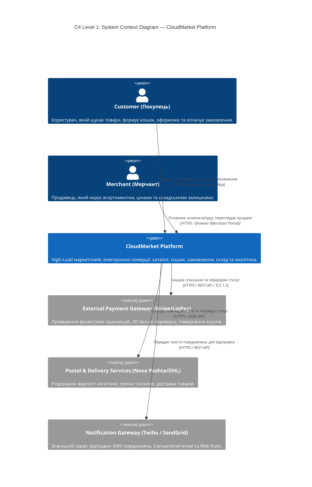
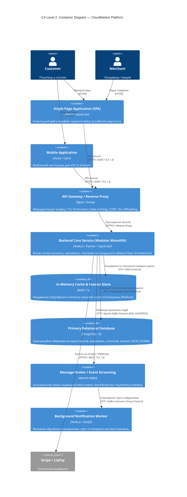
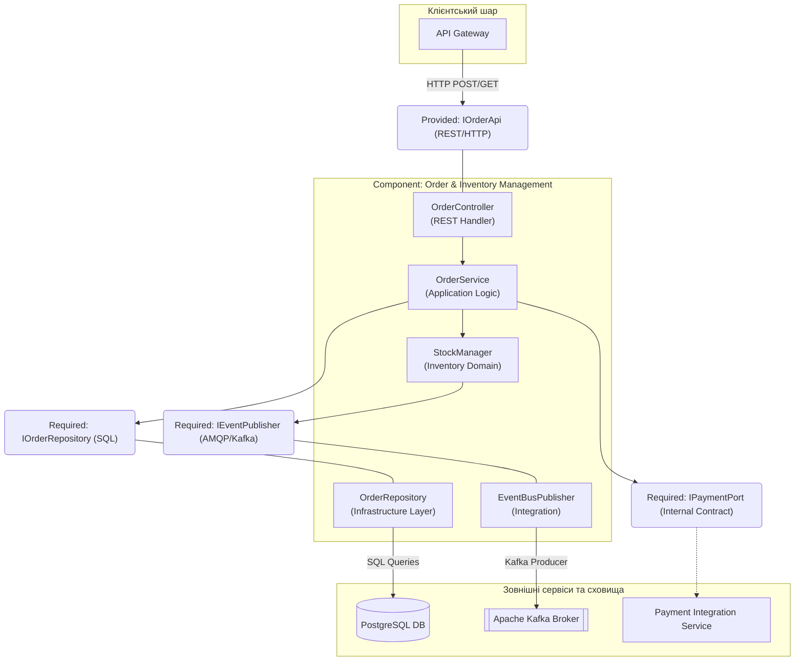
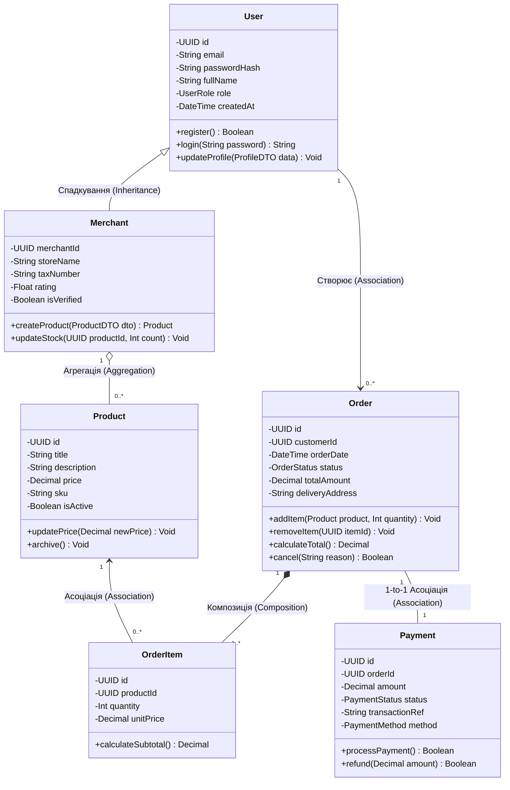
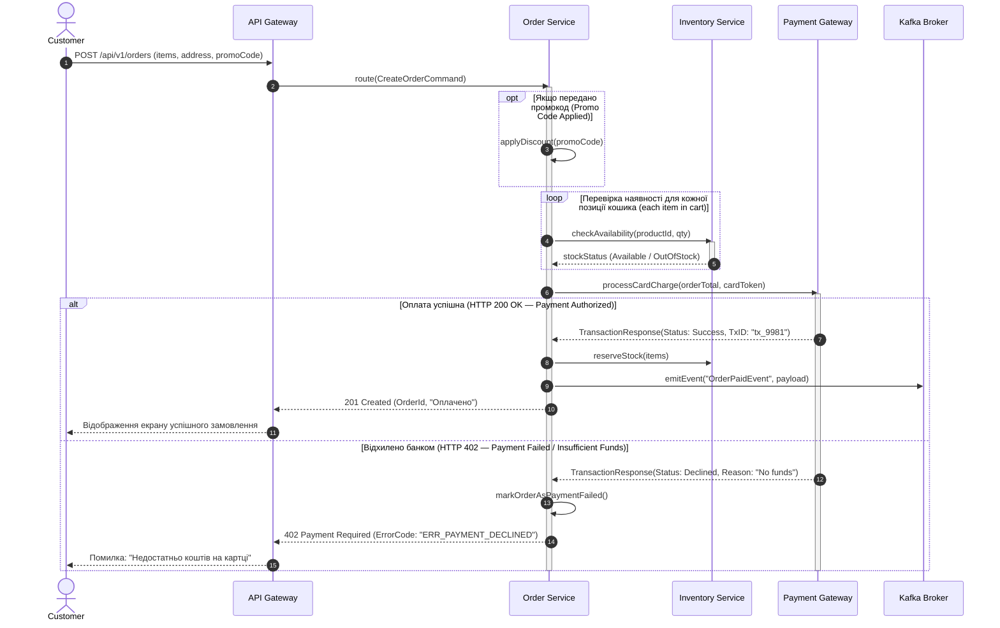
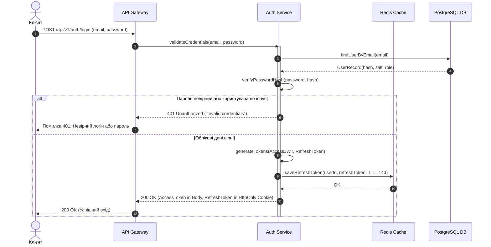
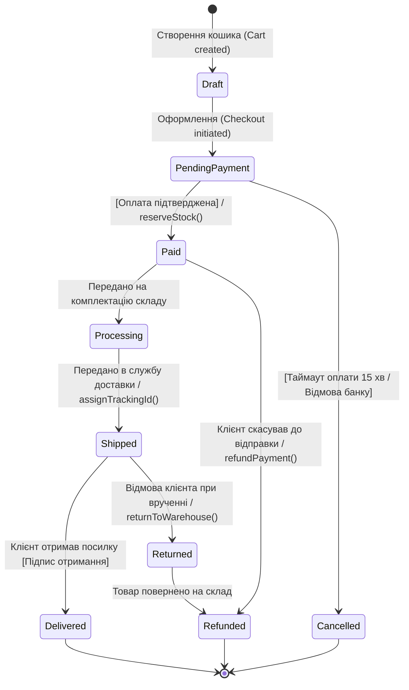

# Звіт до Лабораторної роботи № 2
**Дисципліна:** Проєктування архітектури, специфікація та стандарти інженерії  
**Тема:** Побудова C4 Model, UML-моделювання статичної структури та динаміки поведінки (MILESTONE 2)  
**Варіант 1:** E-Commerce Cloud Platform (CloudMarket)  
**Виконавець:** Назенцева Катерина  
**Репозиторій:** [https://github.com/NazentsevaKateryna/CloudMarket-E-Commerce-Cloud-Platform-High-Load-](https://github.com/NazentsevaKateryna/CloudMarket-E-Commerce-Cloud-Platform-High-Load-)  
**Git-тег:** `lr2`

---

## Розділ 1. C4 Model (Level 1 System Context & Level 2 Container Diagrams)

### 1.1. C4 Level 1: System Context Diagram
Діаграма контексту відображає взаємодію маркетплейсу CloudMarket з основними групами користувачів (покупці, продавці) та зовнішніми інтеграційними сервісами.

---

### 1.2. C4 Level 2: Container Diagram
Діаграма контейнерів системи CloudMarket із зазначенням стеків технологій та конкретних мережевих протоколів комунікації (HTTPS/TLS 1.3, RESP, TCP Native, Kafka Protocol).

---

## Розділ 2. Проєктування статичної структури (UML Component & Class Diagrams)

### 2.1. UML Component Diagram (C4 Level 3) для сервісу замовлень та складу
Діаграма відображає надані (Provided — Ball `O-`) та запитувані (Required — Socket `)-`) інтерфейси ядра платформи.

---

### 2.2. UML Domain Class Diagram (Доменна модель платформи)
Діаграма класів для 6 сутностей домену із зазначенням специфікаторів доступу (`+`, `-`), типів атрибутів, методів та кратності зв'язків.

---

## Розділ 3. Проєктування динамічної поведінки (UML Sequence & State Machine)

### 3.1. UML Sequence Diagram: Оформлення та оплата замовлення (оператори alt, opt, loop)

---

### 3.2. UML Sequence Diagram: Автентифікація клієнта (обробка 401 Unauthorized)

---

### 3.3. UML State Machine Diagram: Життєвий цикл замовлення (Order Entity)

---

## Розділ 4. Відповіді на контрольні запитання

### 1. У чому полягають фундаментальні відмінності між нотацією C4 Model та класичним стандартом UML 2.5?
* **C4 Model** фокусується на ієрархічному масштабуванні архітектури («концепція карт Google Maps»)[cite: 24]: містить фіксовані рівні (Context, Container, Component, Code), прості геометричні блоки та зрозуміла всім стейкхолдерам.
* **UML 2.5** — формальний стандартизований набір із 14 типів діаграм зі суворою семантикою символів (ромбики агрегації/композиції, типи ліній, порти, стереотипи)[cite: 24, 25].

### 2. Яким чином на C4 Container Diagram відображаються виклики між синхронними (REST/gRPC) та асинхронними (AMQP/Kafka) контейнерами?
* **Синхронні:** позначаються суцільною прямою стрілкою від споживача до сервісу із зазначенням блокуючого мережевого протоколу (`HTTPS / JSON`, `HTTP/2`)[cite: 25].
* **Асинхронні:** продюсер шле подію в брокер (`Publish Event` по `Kafka Protocol / TCP`), а консьюмер вичитує повідомлення з черги (`Consume Event`)[cite: 26]. Між продюсером та консьюмером немає прямого зв'язку.

### 3. Що означають поняття Provided («Ball») та Required («Socket») інтерфейсів на діаграмі компонентів UML?
* **Provided Interface («Ball», `O-`):** контракт/інтерфейс, який компонент відкриває назовні та надає іншим (наприклад, REST API чи контролер)[cite: 25, 26].
* **Required Interface («Socket», `)-`):** контракт/інтерфейс, необхідний компоненту від зовнішніх модулів або БД для виконання своєї роботи (наприклад, DB Repository чи виклик платіжного шлюзу)[cite: 25, 26].

### 4. У чому відмінність між агрегацією та композицією на діаграмі класів? Приклад з доменної моделі.
* **Композиція (`*--`):** дочірній об'єкт не може існувати без батьківського (видалення батька знищує дітей)[cite: 26]. *Приклад:* `Order` та `OrderItem` (позиція замовлення не існує окремо від замовлення).
* **Агрегація (`o--`):** дочірній об'єкт має автономний життєвий цикл[cite: 26]. *Приклад:* `Merchant` та `Product` (товар залишається в базі маркетплейсу, навіть якщо продавець тимчасово деактивує акаунт).

### 5. Як на діаграмі послідовностей (Sequence Diagram) моделюється умовне виконання (alt vs opt) та циклічна обробка (loop)?
* **`alt` (Alternatives):** повне розгалуження (як `if-else`)[cite: 25, 26]. Блок розділений пунктиром, виконується строго одна з гілок (успішна оплата або помилка)[cite: 25, 26].
* **`opt` (Option):** умовний блок без альтернативи (як простий `if`)[cite: 25, 26]. Виконується лише якщо умова істинна (наприклад, застосування знижки по промокоду)[cite: 25, 26].
* **`loop`:** циклічне повторення дій для колекції (як цикл `for-each`)[cite: 25, 26].
